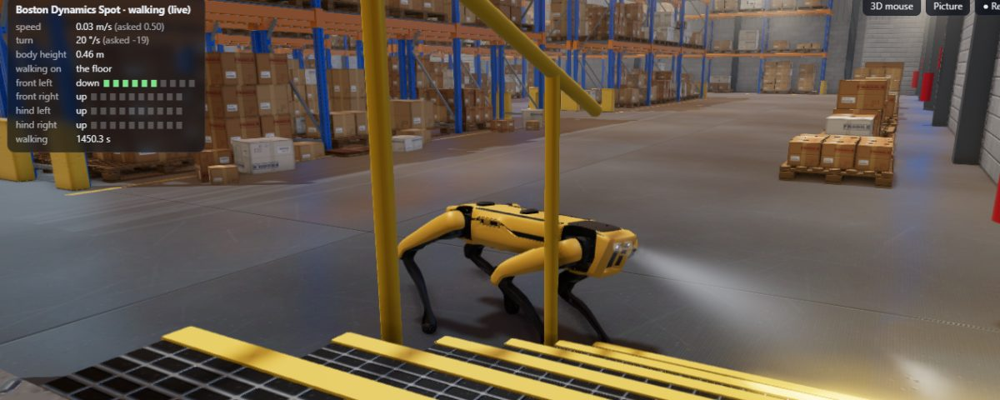

<!-- esasim: cover -->

<!-- /esasim: cover -->

<!-- Banner: upload a picture named banner.png under Data › Readme pictures (Spot inspecting an aisle of racking at night, from the director camera, works well), then:  -->

# Spot · Autonomous Warehouse Security

**A Boston Dynamics Spot learns to stand, to look around, to walk, to climb and to take a shove by reinforcement learning, then patrols a warehouse at night for 30 minutes, live in 3D: it walks its round, hears and sees what happens, investigates, and raises the alarm when there is an intruder.**

Thousands of robots learn at once on your GPU, in MuJoCo physics: to roll over and get up after a fall, to aim their cameras with their legs, to trot at the speed asked, then to cross slopes, stairs, curbs, ice and clutter, under shoves, and finally on the warehouse's own round. Then one robot patrols the warehouse, every step of it in the physics, and writes an incident report at the end.

   -orange)  

## Overview

A security patrol asks a lot of a legged robot. It must walk for half an hour without falling, up and down stairs, round pallets and cartons left on the floor; it must get up on its own if it does fall; and it must point its cameras where it needs to look, which on Spot means moving its whole body, since its cameras are fixed to it.

Nobody writes the walking here. Neural networks (the **policies**) read what a real robot can sense (its speed and turn rates, which way is down, the angle and speed of each joint, what it did last, the command it is given) and set the targets for its 12 joints. They learn by trial and error (PPO, proximal policy optimisation) over hundreds of millions of steps, thousands of robots at once on the GPU. One policy learns to get up, one to look around, and one to walk, which then goes on learning stage after stage: flat floor, obstacle course, shoves, the warehouse.

On rough ground the walking policy also **sees the ground ahead**: an elevation map of the floor in front of it, as its cameras would give it. On a flat floor the map is flat and changes nothing; on stairs it is what lets it place its feet on the treads.

## Flows

Run them in this order:

- **1 · Learn to stand and self-right**: each attempt starts with the robot lying where a fall left it, on its side or on its back. It learns in lessons: first from its side with a help (an upward force and a torque that rolls it upright), then from its back too, the help going down to none. The policy goes to the **spot-policy** dataset (`spot_standup_…pt`), and the patrol uses it to get up after a fall.
- **2 · Learn to walk**: a trot at whatever speed and turn it is asked, and standing still with four feet down when told to stop, on a flat floor, shoved now and then (`spot_walk_…pt`).
- **3 · Learn to look around**: standing with its feet planted, it is asked for a body attitude: nose up or down by up to 26°, turned left or right by up to 29°, between 15 cm lower and 5 cm higher. A new aim comes every 1.5 to 4 s, and it learns to reach and hold each with its legs alone, without slipping or stepping (`spot_look_…pt`).
- **4 · Slopes, stairs and obstacles**: carries on from flow 2 on the obstacle course (below), with the elevation map, in a curriculum of levels; the chart *Curriculum: average level* shows its progress (`spot_walk_course_…pt`).
- **5 · Warehouse surveillance · 30-minute session**: the patrol, live in 3D and in the physics (below). It writes `incident_report.md`, `incidents.json` and `patrol_log.csv`.
- **6 · Take pushes**: the walking policy goes on learning on the obstacle course under a shove every 2 to 5 s, from any side, walking or standing still. Each robot's shoves start at 0.8 m/s and grow toward 2.5 m/s as it copes (`spot_walk_course_push_…pt`).
- **7 · Learn the warehouse**: the walking policy carries on learning in the warehouse itself: the patrol's round, up and down the mezzanine stairs, round the floor pallets and the loose cartons, in a curriculum from the flat floor to the stairs and the cluttered crossings (`spot_walk_warehouse_…pt`).

Each learning run replays one attempt in the 3D view every 20 s and charts its learning curve. Flows 6 and 7 are optional, but they make the patrol much steadier: the patrol walks with the best walking policy it finds, preferring one trained in the warehouse or on the course.

## The robot

| Part | What is simulated |
|---|---|
| **Body** | Boston Dynamics Spot from MuJoCo Menagerie (model by Clearpath Robotics): 12 joints, the real joint limits and mass distribution, **32.5 kg** (Boston Dynamics' figure; the model as published came to 50 kg, so every part's mass and inertia is scaled down in the same proportion) |
| **Motors** | a position loop on each joint (stiffness 300 N·m/rad), limited to Spot's published torques: **45 N·m** at the hips (a 0.88 N·m motor through a 51:1 gear), up to **113 N·m** at the knees |
| **Feet** | spheres with friction on the floor; the body and legs touch the ground too when it falls |
| **Sensors** | the body IMU (gyro, gravity), joint angles and speeds; on rough ground the elevation map ahead |
| **Cameras** | fixed to the body, looking forward: 110° field of view, 14 m range in the patrol; to look elsewhere it moves its body |
| **Self-righting** | like the real Spot, it rolls over from its back and stands up (flow 1) |

Boston Dynamics gives the knee 30.6 to 113.2 N·m depending on its angle; the simulation allows the peak at every angle, so a deeply bent knee is somewhat stronger than the real one.

## The obstacle course

Flows 4 and 6 learn on a course of bumps, blocks, a 12.5 % slope up to a plateau and down, ten 12 cm steps up and ten down, practice stairs of 6 to 15 cm, curbs, moving tiles and ice.

Each robot starts on a level and moves up one when it walks a whole try without falling, down one when it falls early:

| Level | Ground |
|---|---|
| **0** | flat |
| **1** | 6 cm stairs, ice and slopes |
| **2** | 9 cm stairs, moving tiles and rough ground |
| **3** | 12 cm stairs |
| **4** | 15 cm stairs and anywhere on the course |

## The warehouse

A 42 × 28 m hall at night:

| Where | What |
|---|---|
| **Loading docks** | four roller doors along the south wall, the dock aisle in front of them, a 5 cm cable protector across it |
| **Aisles A, B, C** | three double rows of 8 m pallet racking, full of goods, with a cross aisle in the middle; aisles 4 m wide, room for a forklift to turn |
| **Clutter** | in aisles B and C, pallets left on the floor (14 cm) and cartons fallen from the racks, kept to the rack faces; the cartons are loose, and the robot can knock them about |
| **West racking** | a single row along the west wall |
| **Staging area** | stretch-wrapped pallets of goods along the north wall |
| **East floor** | a roller conveyor along the east and dock walls, loading bays with pallets, a recycling bin, two forklifts parked |
| **Mezzanine office** | 84 cm up, glass walls, a desk and chairs; reached by **7 steps of 12 cm** (the ramp is for trolleys); the robot's **charging dock** is beside the office |

The walls, racking, stacks, office, conveyor and forklifts are real obstacles in the physics, and the stairs and mezzanine are real heights. The 3D view draws the warehouse with shadows, lamp light and surface relief on its materials: sealed concrete, steel panels, perforated racking, cardboard, pallet wood, stretch wrap and steel grating.

## The patrol

**Always in the physics.** Every step Spot takes comes from its walking policy acting in MuJoCo. You can push it by hand: click **Push**, then click the robot where you want to push it; **Push strength** sets how hard. With a policy that has learned only the flat floor, its round keeps to the flat floor: it leaves out the areas behind stairs or clutter, starts and ends at the foot of the mezzanine stairs, and says so. Without a walking policy the patrol stops at the start and says what to wire.

**Its round.** It patrols the areas listed in *Areas to patrol*: `all`, area names (Loading docks, Aisle A, Aisle B, Aisle C, Staging area, East floor, West racking, Mezzanine office), or your own as `Name: x y; x y` (metres; x along the south wall, dock 1 at x 3; y toward the north wall, 0 at the dock aisle). It plans its way with A* on a 20 cm map of the floor, round what lies on it. At each area's checkpoint it stops to look: with the look-around policy it aims its cameras with its body, along the racks up to the top levels, then down to the floor. After a fall it gets up with the stand-up policy; if it is still down after 20 s, it alerts the operator and is put back on its feet. When the session ends, it walks back up to the mezzanine and backs onto its charging dock.

**Its senses.**

- **Hearing**: a sound gets 6 dB quieter each time the distance doubles, and another 6 dB through each block of racking or wall; below 42 dB the robot does not notice it.
- **Sight**: the cameras' 110° field of view and 14 m range, with a clear line of sight.

**What happens.** Incidents come at random times and places that the robot does not know in advance: a carton falls from a shelf, a dock door rattles in the wind, and once a session an intruder forces a dock door. The robot goes to where the sound came from, finds what made it and decides what it is. A carton or a door is **logged**. A person without a badge **raises the alarm**: the siren sounds, the operator is alerted, and the robot follows the person at a distance until they leave. Then it picks up its round where it left off, so no area is skipped.

## Where it runs

- **NVIDIA GPU**: the way to train. MuJoCo Warp runs the whole simulation on the card. On one GPU with 4,096 robots, plan on about 1 hour for flow 1, 1.5 hours for flow 2, 45 minutes for flow 3, 2 hours for flow 4, 1 hour for flow 6 and 2 hours for flow 7.
- **CPU**: works, with at most 512 robots at once; it learns far more slowly, fine to try it.
- Flow 5 runs on any machine: one robot, in real time, on the CPU.

## What you need

- A machine with the EsaSim worker (Project › Compute), with an NVIDIA GPU for training. If PyTorch on that machine cannot use the GPU, the block installs the CUDA build that the driver supports, by itself, before it trains.
- Python packages, installed by the worker the first time: `torch` (with CUDA on NVIDIA machines), `mujoco`, `mujoco-warp`, `warp-lang`. Nothing else is downloaded and no account or key is needed.
- Somewhere for the policies: the **spot-policy** dataset, made by the first training run.

## How to run it

**If you took this project from Demos**, first tell it where your policies live (a copy keeps no link to anyone else's storage):

1. Open each learning flow (1, 2, 3, 4, 6 and 7) under **Blueprint**, select the training block and set **Outputs go to** to a place in your workspace, with the dataset name `spot-policy`.
2. Once the dataset exists, set the **Policies** block of every flow to it.

Then:

1. Under **Compute**, check that a machine with an NVIDIA GPU is available for this project. With *Run on: auto* the learning flows go to it, and wait for it if it is off.
2. Run **1 · Learn to stand and self-right**, **2 · Learn to walk** and **3 · Learn to look around**. **Finish now** ends a run early and still keeps the best policy.
3. Run **4 · Slopes, stairs and obstacles**, then **6 · Take pushes** and **7 · Learn the warehouse**. Each carries on from the walking policy with the most experience so far.
4. Run **5 · Warehouse surveillance**. Watch the 3D view, push the robot, and use **Intruder drill** to show an intrusion on demand. Read the report when the session ends.

Policies trained before block version 7 learned on a heavier, stronger Spot (50 kg): train the flows again.

## Settings worth knowing

- **Learning flows**: **Ground** (Flat floor, Obstacle course or Warehouse), **Robots learning at once** (4,096 on a GPU), **Minutes**, **Top speed asked** (1.2 m/s), **Pushes up to** (Learn to walk: a shove every 5 to 10 s; Learn to take pushes: up to this, at least 2.5 m/s, every 2 to 5 s), **Replay every** (20 s), **Training** (Continue: from the newest policy wired in, or a stopped run's checkpoint on the machine; Start over: from nothing).
- **Patrol**: **Minutes** (30), **Walking speed** (0.8 m/s), **Walking policy** (empty: the best one wired in), **After a fall**, **Areas to patrol**, **Incidents** (Demo: about one every 90 s; Realistic: about one every 4 minutes; None), **Seed** (which night you get: the same seed gives the same night; 0 a new one each run), **Patrol starts at** (the clock shown, 22:00), **Pace** (As fast as it can: the full report in seconds, nothing to watch).
- In the main view's bar: **Push**, **Push strength**, **Acknowledge alarm**, **Intruder drill** (an intruder enters now), **End patrol** and **Speed**. The view's own buttons turn the hall's lights, the mission log, the sound and the sensors on or off.
- Fixed views beside the main one: the robot's **front camera** and its **sensors** (the telemetry window).

## What you get

- In the **spot-policy** dataset: `spot_standup_<date>_<NN>.pt`, `spot_look_<date>_<NN>.pt`, `spot_walk_<date>_<NN>.pt`, `spot_walk_course_<date>_<NN>.pt`, `spot_walk_course_push_<date>_<NN>.pt` and `spot_walk_warehouse_<date>_<NN>.pt`: the policy (network, input scaling, the ground it learned on, its score NN %, its steps of experience).
- **training.csv**, **standup.csv** and **look.csv**: the learning curves.
- From the patrol: **incident_report.md** (what happened, when, where, what the robot did), **incidents.json**, and **patrol_log.csv** (once a second: where it was, what it was doing, its battery).
- Live in the views: the replayed attempts while learning; the patrol with the mission panel (time, state, area, battery, distance, incidents, alarms, where the cameras point), the event feed and a map of the hall, its route and field of view, sound rings, people, alarm beacons and the siren.

## Data and licences

- No dataset is read: every step is simulated.
- Spot physics model: MuJoCo Menagerie (Google DeepMind; the model by Clearpath Robotics, BSD-3-Clause), masses scaled to Spot's 32.5 kg. MuJoCo and MuJoCo Warp by Google DeepMind (Apache 2.0). The 3D view draws Spot from the Menagerie meshes, in its yellow and black.
- Person and forklift models: Next Stop Willoughby, Kamran Mughal (CC BY 4.0).
- The robot's figures: [About Spot](https://dev.bostondynamics.com/docs/concepts/about_spot) (weight), [joint control supplemental data](https://dev.bostondynamics.com/docs/concepts/joint_control/supplemental_data) (hip motors and gearing), [knee torque limits](https://dev.bostondynamics.com/docs/concepts/joint_control/knee_torque_limits), all by Boston Dynamics.
- The code of the blocks is EsaSim's.

## Notes

- The locomotion is learned, not scripted: every step, in training and in the patrol, comes from the networks acting in the physics. A policy still learning will stumble and fall in the warehouse as it would anywhere.
- The incidents and senses are simplified models on purpose. Alarms are not connected to a real security system.
- This is a simulation, not a validated digital twin, and not a Boston Dynamics product. Real Spot hardware has its own controller and Autowalk missions.

<!-- esasim: files of the project -->

---

An [EsaSim](https://esacode.com/) project of the workspace Gianluca De Novi's workspace (Robotics & manipulation).

### Blueprints in this repository

- [1 · Learn to stand and self-right](blueprints/1-learn-to-stand-and-self-right.json) · 10 blocks · version 7
- [2 · Learn to walk](blueprints/2-learn-to-walk.json) · 10 blocks · version 6
- [3 · Learn to look around](blueprints/3-learn-to-look-around.json) · 9 blocks
- [4 · Slopes, stairs and obstacles](blueprints/4-slopes-stairs-and-obstacles.json) · 12 blocks · version 6
- [5 · Warehouse surveillance · 30-minute session](blueprints/5-warehouse-surveillance-30-minute-session.json) · 10 blocks · version 9
- [6 · Take pushes](blueprints/6-take-pushes.json) · 9 blocks · version 3
- [7 · Learn the warehouse](blueprints/7-learn-the-warehouse.json) · 12 blocks · version 4

### Workspace blocks it uses

- [Quadruped · Spot](blocks/ws-quadruped-spot) · version 26

### Assets

The files the project's views draw with (3D models, textures, sounds), in [assets/](assets/):

- [audio/soundtrack.mp3](assets/audio/soundtrack.mp3) · 3.2 MB
- [models/forklift.glb](assets/models/forklift.glb) · 773 KB
- [models/g1.glb](assets/models/g1.glb) · 5.8 MB
- [models/person.glb](assets/models/person.glb) · 3.2 MB
- [models/roadster.glb](assets/models/roadster.glb) · 1.8 MB
- [models/robot-apollo.json](assets/models/robot-apollo.json) · 2.1 MB
- [models/robot-h1.json](assets/models/robot-h1.json) · 1.1 MB
- [models/robot-spot.json](assets/models/robot-spot.json) · 7.0 MB
- [spot-policy/spot_standup_20261113_1803_05.pt](assets/spot-policy/spot_standup_20261113_1803_05.pt) · 5.4 MB
- [spot-policy/spot_standup_20261113_2305_04.pt](assets/spot-policy/spot_standup_20261113_2305_04.pt) · 5.4 MB
- [spot-policy/spot_standup_20261113_2334_03.pt](assets/spot-policy/spot_standup_20261113_2334_03.pt) · 5.4 MB
- [spot-policy/spot_walk_20261114_0105_92.pt](assets/spot-policy/spot_walk_20261114_0105_92.pt) · 5.4 MB
- [spot-policy/spot_walk_course_20261114_0326_75.pt](assets/spot-policy/spot_walk_course_20261114_0326_75.pt) · 5.4 MB
- [spot-policy/spot_walk_course_20261114_1907_76.pt](assets/spot-policy/spot_walk_course_20261114_1907_76.pt) · 5.4 MB
- [spot-policy/spot_walk_course_push_20261115_0154_78.pt](assets/spot-policy/spot_walk_course_push_20261115_0154_78.pt) · 5.4 MB
- [spot-policy/spot_walk_warehouse_20261114_2159_68.pt](assets/spot-policy/spot_walk_warehouse_20261114_2159_68.pt) · 5.4 MB
- [textures/esacode-logo.png](assets/textures/esacode-logo.png) · 25 KB
- [textures/flashlight.jpg](assets/textures/flashlight.jpg) · 5.3 KB
- [textures/spot-policy/spot_standup_20261113_1803_05.pt](assets/textures/spot-policy/spot_standup_20261113_1803_05.pt) · 5.4 MB
- [textures/spot-policy/spot_standup_20261113_2305_04.pt](assets/textures/spot-policy/spot_standup_20261113_2305_04.pt) · 5.4 MB
- [textures/spot-policy/spot_standup_20261113_2334_03.pt](assets/textures/spot-policy/spot_standup_20261113_2334_03.pt) · 5.4 MB
- [textures/spot-policy/spot_walk_20261114_0105_92.pt](assets/textures/spot-policy/spot_walk_20261114_0105_92.pt) · 5.4 MB
- [textures/spot-policy/spot_walk_course_20261114_0326_75.pt](assets/textures/spot-policy/spot_walk_course_20261114_0326_75.pt) · 5.4 MB
- [textures/spot-policy/spot_walk_course_20261114_1907_76.pt](assets/textures/spot-policy/spot_walk_course_20261114_1907_76.pt) · 5.4 MB
- [textures/spot-policy/spot_walk_course_push_20261115_0154_78.pt](assets/textures/spot-policy/spot_walk_course_push_20261115_0154_78.pt) · 5.4 MB
- [textures/spot-policy/spot_walk_warehouse_20261114_2159_68.pt](assets/textures/spot-policy/spot_walk_warehouse_20261114_2159_68.pt) · 5.4 MB

Keys pasted in blocks (secret settings) are not saved here, nor are the team and the results of runs.
